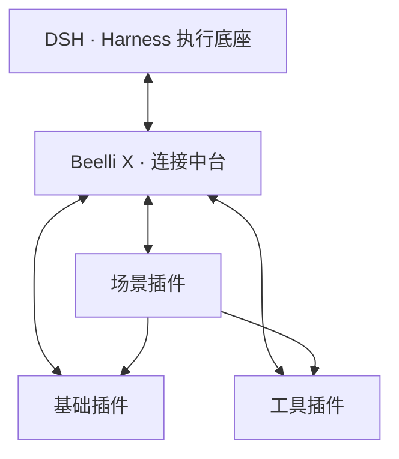

# Beelli X 中台插件 社区版

**Harness-Based Agentic Data Engineering**

基于 DSH 的开源连接中台，通过统一的插件与数据契约，将场景应用、工具和公共能力接入 Harness 执行底座。

**版本：0.1.1 · 许可证：MIT**

[官网](https://www.beellix.com) · [快速开始](https://github.com/Beellix-dev/dsh-beellix-plugin/blob/main/docs/getting-started.md) · [产品说明](https://github.com/Beellix-dev/dsh-beellix-plugin/blob/main/docs/product-overview.md) · [开发标准](https://github.com/Beellix-dev/dsh-beellix-plugin/blob/main/standards/README.md) · [文档](https://github.com/Beellix-dev/dsh-beellix-plugin/blob/main/docs/README.md)

## 概述

以数据中台为核心，基于 Harness 执行底座，通过插件化能力驱动个人、团队与企业的 AI 场景应用，构建数据互通的智能执行闭环，实现能力持续复用与生态演进。

Beelli X 围绕三个相互配合的部分构建应用体系：

- **通用执行**：由 DSH 提供智能体运行与任务执行能力。
- **中台连接**：组织数据、模型、插件及应用之间的接入关系。
- **场景复用**：将专业业务能力封装为可安装、配置和组合的场景插件。

用户可以从单个场景开始，接入自己的数据与所需能力，逐步组合成适合自身业务的应用系统。

## 架构



### DSH 执行底座

复用 DSH 原生的智能体运行、会话、上下文、工具、技能、子代理及执行控制。插件通过宿主机制注册能力，并在对应任务作用域中参与执行。

### Beelli X 连接中台

提供插件管理、模型配置、资源接入和场景组织能力，维护插件之间的依赖、配置与公共契约。

中台连接执行底座与业务能力。具体业务处理由场景实现，公共服务由基础插件提供，专项操作由工具插件完成。

### 场景应用

场景以业务目标组织界面、数据、规则和智能体能力，形成用户可以直接操作的应用。

多个场景通过公开接口和数据契约协作，保留各自的专业职责与维护边界。

## 插件模型

Beelli X 使用三类插件：

| 类型 | 职责 |
| --- | --- |
| **基础插件** | 提供共享服务、数据连接、存储及其他公共能力；核心部分主要由 Beelli X 维护 |
| **场景插件** | 封装面向业务目标的应用，是生态共创和应用组装的主要单位 |
| **工具插件** | 提供具有明确输入、输出和操作边界的可复用执行能力 |

一个插件可以包含多种运行资源。UI、工具、Skills、专业提示词和数据结构按需要随所属插件交付。

### 场景分类

场景按主要工作性质进行二级分类：

| 分类 | 定义 |
| --- | --- |
| **经营管理** | 管理持续发生的业务、对象、单据与状态 |
| **专业作业** | 按专业规则完成处理、计算、设计与交付 |
| **内容创作** | 制作、编辑和管理内容成果 |
| **分析研究** | 围绕问题处理资料与数据，形成有依据的分析结果 |

行业、适用对象和能力标签用于进一步检索。分类描述应用用途，插件清单及接口声明描述实际能力。

## 数据互通

数据互通建立在明确的数据归属与业务接口之上。

- **归属明确**：业务记录由负责该领域的服务维护，公共存储与知识能力由相应基础插件提供。
- **对象可关联**：跨应用引用保留对象标识、来源及必要版本信息。
- **操作有契约**：数据读取和业务动作通过公开接口执行，由提供方校验业务规则与访问范围。
- **结果可积累**：任务产出保存为业务记录或成果，供后续应用继续使用。

界面与智能体使用同一套业务服务，保持数据和处理规则一致。各插件可以独立存储，通过受控接口协作。

Harness 运行上下文与持久化业务数据分别管理。任务按需获取相关记录、知识与证据，完整资料留存在对应数据服务中。

## 应用组装

应用系统由场景插件及其所需能力共同组成。装配关系需要明确：

1. **应用组成**：选择哪些场景，各自承担什么业务。
2. **能力依赖**：需要哪些基础插件、工具、模型和外部服务。
3. **数据关系**：数据来源、对象关联、字段对应及存储归属。
4. **业务衔接**：允许执行的动作、业务条件和结果交接方式。
5. **运行配置**：初始化、访问范围、兼容要求及恢复方式。

应用套件可以记录上述组合关系，形成可复用的装配方案。实际组合按各插件支持的契约和验证范围实施。

## 安装

在 DSH 中打开 **插件 → 添加插件**，填写：

```text
https://github.com/Beellix-dev/dsh-beellix-plugin
```

完成安装后，从 **更多 → Beelli X 中台** 进入，初始化或选择已有资料目录，配置模型并按需接入插件。

安装渠道、环境要求和操作步骤见[快速开始](https://github.com/Beellix-dev/dsh-beellix-plugin/blob/main/docs/getting-started.md)。兼容范围与测试记录见[验证说明](https://github.com/Beellix-dev/dsh-beellix-plugin/blob/main/docs/verification.md)。

## 开发与共创

生态以场景插件为主要建设方向。贡献者可以将专业知识、业务规则和操作方法实现为应用，也可以提供基础能力或通用工具，供其他场景复用。

插件开发遵循共同的身份、依赖、数据、模型、接口、界面及交付规范。人工开发、开发助手和 DSH 创造模式使用同一套标准。

- [开发指南](https://github.com/Beellix-dev/dsh-beellix-plugin/blob/main/docs/development.md)
- [插件开发标准](https://github.com/Beellix-dev/dsh-beellix-plugin/blob/main/standards/README.md)
- [贡献指南](https://github.com/Beellix-dev/dsh-beellix-plugin/blob/main/CONTRIBUTING.md)
- [问题反馈](https://github.com/Beellix-dev/dsh-beellix-plugin/issues)

[Beelli X 官网](https://www.beellix.com)承担作品发现、发行获取和需求协作；本项目负责将生态能力接入 DSH，并组织用户环境中的应用与数据连接。

## 文档

- [产品说明](https://github.com/Beellix-dev/dsh-beellix-plugin/blob/main/docs/product-overview.md)
- [功能说明](https://github.com/Beellix-dev/dsh-beellix-plugin/blob/main/docs/features.md)
- [模型与配置](https://github.com/Beellix-dev/dsh-beellix-plugin/blob/main/docs/configuration.md)
- [架构与接入](https://github.com/Beellix-dev/dsh-beellix-plugin/blob/main/docs/architecture.md)
- [数据与隐私](https://github.com/Beellix-dev/dsh-beellix-plugin/blob/main/docs/data-and-privacy.md)
- [验证与兼容](https://github.com/Beellix-dev/dsh-beellix-plugin/blob/main/docs/verification.md)
- [完整文档导航](https://github.com/Beellix-dev/dsh-beellix-plugin/blob/main/docs/README.md)

## 许可证

本项目采用 [MIT](LICENSE) 许可证。第三方代码与素材遵循其原有许可及署名要求，详见[第三方声明](THIRD_PARTY_NOTICES.md)。

安全问题请通过[安全报告入口](https://github.com/Beellix-dev/dsh-beellix-plugin/blob/main/SECURITY.md)反馈。
