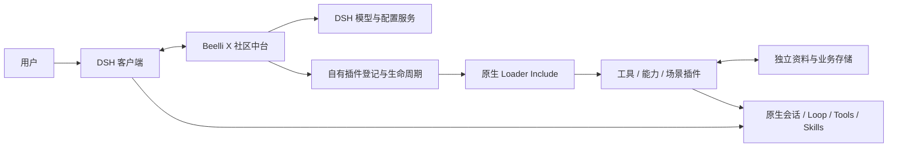

# 架构与职责

[文档中心](README.md) / 架构

Beelli X 是 DSH 原生扩展，社区中台不是另一套客户端、Agent Loop 或聊天数据库。

## 边界

| 层 | 负责 | 不负责 |
| --- | --- | --- |
| DSH | 原生会话、执行循环、工具调度、技能、子代理、宿主权限 | 不由本包复制重写 |
| 社区中台 | 品牌与导航、模型配置、自有插件管理、资料目录、会话知识选择 | 不实现所有业务、多人身份或服务器 |
| 业务与能力插件 | 业务规则、领域数据、工作台、专用模型与迁移 | 不绕过中台归属或宿主执行约束 |

## 两条接入链路

**安装：** DSH 加载根包 Bundle → 注册社区入口 → 用户初始化独立目录 → 中台校验业务包声明及依赖 → 原生 Loader Include 加载贡献。失败处理保留原资料并按操作事务恢复登记，不靠隐藏原生市场的 DOM 来管理业务包。

**执行：** 用户发起原生会话 → 中台核对工作区或场景绑定 → DSH 在当前作用域加载对应贡献 → 业务插件执行自身逻辑 → 按宿主审核及业务事务提交 → 返回有界结果。模型上下文按需读取，不预先注入全部场景和知识。

社区版沿本机 owner 身份默认授权，但不自动批准写入，不把插件包名当作人的身份。数据接口详见[本机数据访问契约](personal-data-permissions.md)。

## 源码入口

| 入口 | 位置 |
| --- | --- |
| 原生 Bundle | `cordis.patch.yml` |
| 宿主装配 | `packages/platform/community/src/host.mjs` |
| 客户端装配 | `packages/platform/community/src/client.mjs` |
| 中台页面 | `packages/platform/community/src/console-page.tsx` |
| 公共运行适配 | `dev/shared/runtime/` |
| 创造模式规则 | `src/creation-runtime.mjs`、`src/development/`（社区源码目录内） |

根 `lib` 是供 DSH 直接安装的预构建结果，修改应从源码和构建脚本开始。其他业务包和企业服务不在本仓库。

少量目录标记和兼容接口保留历史稳定 ID，它们不等于当前 npm 包名；不要按品牌字符串批量替换，以免已有资料目录或会话无法重新接入。
