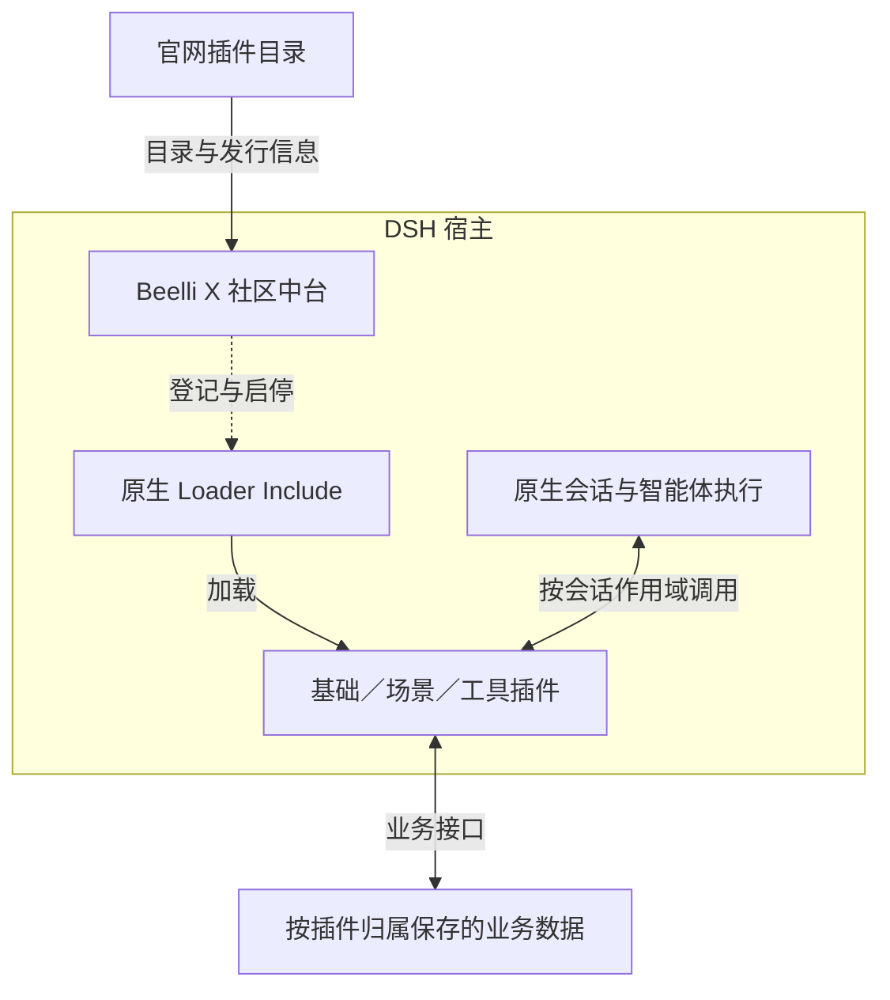

# 架构与职责

[文档中心](README.md) / 架构

本页说明 Beelli X 中台插件 社区版的实现结构。产品定位、插件分类与应用组装见[产品说明](product-overview.md)。社区中台以插件形式运行在DSH的宿主服务与客户端中；官网是外部目录与发行服务，会话、Agent Loop与执行记录由DSH管理。

虚线表示管理关系，实线表示信息、加载或业务调用关系。场景按实际需要声明基础能力和工具依赖，三类插件不是必须依次经过的执行层次。

## 边界

| 组件 | 职责 | 接入方式 |
| --- | --- | --- |
| DSH | 原生会话、执行循环、工具调度、技能、子代理与宿主权限 | 原生服务及作用域 |
| 社区中台 | 品牌与导航、模型配置、自有插件管理、资料目录与会话知识选择 | Bundle、客户端扩展与管理服务 |
| 业务与能力插件 | 业务规则、领域数据、工作台、专用模型与迁移 | 中台契约及原生 Loader Include |
| 官网 | 插件目录、发行记录与获取服务 | 公开HTTP API；发现内容在DSH内展示 |

产品按基础、场景和工具三类插件组织；工具、Skills、UI 和服务等贡献描述包内部的技术资源。产品分类文案不改写既有运行身份、兼容字段或数据归属。

## 发现、加载与执行

**发现与安装：** DSH加载社区入口Bundle，宿主自动初始化安全的中台资料根。DSH内发现页读取官网目录；用户确认后，中台校验业务包身份、发行、摘要及依赖，安装到自有环境并维护registry。官网发布成功、客户端下载成功与安装完成分别报告。

**加载与启停：** DSH原生插件管理登记社区入口；中台管理的业务包经原生Loader Include加载，不分别登记为Profile的独立Bundle。中台维护启用意图、依赖状态及自身登记，宿主负责运行贡献的生命周期。失败按安装事务处理，业务资料保留。

**会话与业务执行：** 普通聊天沿原生工作区、预设及模型链路执行。场景会话由中台核对显式绑定及对应包组成，DSH在当前作用域调用插件贡献；插件业务服务按宿主审核与业务事务规则处理并返回有界结果。模型上下文按需读取，界面与工具共用业务服务。

DSH保存原生会话与执行记录，插件业务服务保存领域数据、知识及成果。会话执行目录、场景归属与业务存储分别维护；存储方式由插件声明和依赖决定。中台资料根已初始化不表示数据库、知识库或场景业务已经就绪。官网目录请求不以客户会话或业务库为输入；未完成的公网与完整运行验收见[验证说明](verification.md)。

社区版沿本机owner身份默认授权，业务写入仍沿对应的原生审核和事务规则，包名不作为人的身份。数据接口详见[本机数据访问契约](personal-data-permissions.md)。

## 源码入口

| 入口 | 位置 |
| --- | --- |
| 原生 Bundle | `cordis.patch.yml` |
| 宿主装配 | `packages/platform/community/src/host.mjs` |
| 客户端装配 | `packages/platform/community/src/client.mjs` |
| 中台页面 | `packages/platform/community/src/console-page.tsx` |
| 公共运行适配 | `dev/shared/runtime/` |
| 创造模式规则 | `src/creation-runtime.mjs`、`src/development/`（社区源码目录内） |

根 `lib` 是供 DSH 直接安装的预构建结果，修改从源码和构建脚本开始。本仓库交付社区入口；业务包独立安装、维护源码及验收，不随入口自动包含。

少量目录标记和兼容接口保留历史稳定 ID，它们不等于当前 npm 包名；不要按品牌字符串批量替换，以免已有资料目录或会话无法重新接入。
