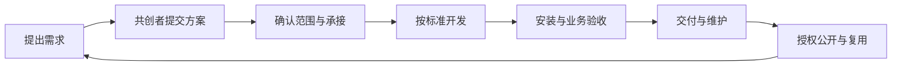

# 共创生态

[文档中心](README.md) / 生态协作

Beelli X 以开放使用与社区共创积累可复用能力，通过需求协作、持续维护和团队企业服务形成发展循环。本页说明产品与协作模式，服务接入状态见[验证说明](verification.md)。

## 参与方式

| 参与者 | 主要活动 |
| --- | --- |
| 使用者 | 发现作品、安装应用、使用反馈、提出需求 |
| 共创者 | 提交方案、贡献作品、承接定制、交付与维护 |
| 团队与企业 | 组织共享使用、配置人员权限、提出部署与集成需求 |
| 平台维护者 | 维护标准、审核发行、组织协作、处理安全与治理事项 |

平台采用统一账号体系。作者与维护者关联到作品，团队成员关联到工作空间；同一用户可以参与多类活动。注册、公开需求和免费资源使用面向社区开放。

## 需求到交付

想法讨论、自愿共创和有预算的定制分别标明协作条件。承接前确认范围、里程碑、验收、成果权属、维护和费用安排；变更保存独立记录。

客户资料、私有方案和业务成果按参与关系授权访问。交付验收与公开发行分别确认，经过授权的通用能力再进入生态目录。

## 作品与发行

作品按主要用途组织为场景包、工具包、技能包、基础能力、UI 扩展及资料资源；一个插件可同时提供页面、工具、技能和模型用途。

代码插件通过[开发标准](../standards/README.md)描述能力与依赖。发行固定源码修订、安装包摘要、许可、兼容环境和验收记录。官网负责发现与获取，中台负责安装、配置及运行接入，DSH 负责执行。

源码许可、使用价格、部署方式与服务范围分别说明。本社区入口采用 MIT；第三方作品保留其明确的许可及署名。

## 团队与企业服务

社区版从本地 DSH 和免费开源入口起步。团队与企业形态在本地执行端之外，提供共享中台、统一模型接入、共享数据服务、人员授权与审计，以及部署、集成和维护服务。

企业权益按工作空间描述可获得的产品与服务范围。具体业务数据的访问由工作空间内的人员权限决定，账号权益与数据权限分别校验。

共创者通过定制交付、维护服务及约定的企业权益收益参与回报分配。合作范围、收益口径、结算周期与各方责任在对应协议中明确，订单、验收、应付和实际付款分别记录。

## 开放治理

作品保持可追溯的作者、来源、发行与维护记录。反馈、版权、安全、协作争议分别处理；维护者交接沿作品关系确认。客户环境中的业务资料、凭据与会话由对应数据服务管理，成果分享按用户授权执行。

生态协作的技术检查项见[验收清单](ecosystem-model.json)，社区入口功能见[功能说明](features.md)。
