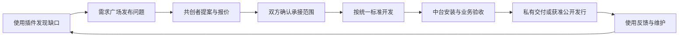

# Beelli X 共创生态模式

> 本文为生态共创规划。社区入口已公开源码；需求广场、作者结算及网站服务不属于本仓库已交付能力。

2026-10-28。当前方向为**生态先行、真实交付、收益共享**。本文件统一产品与协作规则；[机器清单](ecosystem-model.json)记录对象、流程、缺口和验收。它们是设计基线，不表示接单、付款或分账已实现。开发标准仍1.1.0，自有插件仍0.1.1。

## 1. 生态闭环

前期先完成可以反复运行的闭环，衡量真实使用、交付、复用和维护；不以插件数量、会员数量或页面数量代替。注册、公开需求、提案和免费资源不以付费会员为前提。开发环境、试点和公网服务分别验收，不因有本机网站就开放真实资金或不可信代码。

## 2. 职责与身份

| 对象 | 责任 |
| --- | --- |
| DSH | 原生对话、执行、工具、技能、审批、上下文及子代理 |
| Beelli X 中台 | 安装、配置、公共数据／模型能力、场景与交付版本管理 |
| 官网与市场 | 需求协作、作者作品、发行目录、获取方式、评价与收益事实 |
| 共创者 | 真实方案、源码与来源、测试、交付、维护和风险说明 |
| 需求方 | 合法输入资料、范围与预算、验收和范围变更确认 |
| 平台维护者 | 规则、技术准入、审核、发行、争议协调和可核对结算 |

作者、发布者、维护者分别记录；平台发布不抹去作者署名。购买者、组织成员和业务管理员也分别记录。网站身份不自动取得客户本机权限；付费、需求被承接、技术验收和发行批准不能相互代替。

## 3. 三类需求

| 类型 | 默认规则 |
| --- | --- |
| 想法与讨论 | 不承诺报酬；用问题、输入和期望结果寻找共识 |
| 自愿共创 | 明确无报酬或尚未确定，贡献前确认署名、许可、成果可见范围和维护责任 |
| 有预算的定制 | 明确预算、范围、交付、验收、维护及结算安排；未确认资金安排不得展示已保障或已托管 |

公开摘要只展示可公开的问题和样例。客户附件、真实业务数据、私有源码和报价默认只向指定参与者开放；公开需求不等于附件公开。发布前确认资料可披露，开发优先使用脱敏样例。

## 4. 提案、承接与变更

共创者提交方法、相关作品、报价／无偿说明、周期、依赖和风险。各家报价与私有方案互不可见；需求方按能力、范围和交付可靠性选择，不自动按最低价决定。

选中提案后形成独立承接记录，双方确认同一修订的范围、里程碑、验收、权属、维护和费用安排。选中、开始工作、交付、验收、发行、付款分别保存状态。页面只给当前角色一项主要动作，其余沿需求详情进入，不另造多套接单门户。

变更另记范围、费用、周期和验收影响，双方确认后生效；不回写原协议。取消、延期、返修、换作者和争议保留原记录与已完成工作，平台只能按既定职责协调，不能替客户验收或替作者同意权益。

## 5. 开发、交付与发行

开发任务沿[统一任务单](../standards/plugin-development-task.md)和[技术准入](../standards/ecosystem-conformance.md)。需求、承接和里程碑ID记录在协作／交付回执，不向现行工程Schema塞入未支持字段。Codex与DSH创造模式使用同一标准，只按当前任务读取必要资料。

每次交付固定源码／来源修订、安装包SHA-256、支持环境、测试回执、许可和操作说明。中台安装成功只是技术事实；需求方还需对约定输入、产出、失败处理和业务正确性验收。返修生成新交付版本，旧证据保留。

客户确认交付不直接使插件公开。公开发行另过G0—G4及独立审核，固定审核对象与最终包摘要。平台不能执行未知包来完成审核，缺少隔离构建、安全或宿主验证时保持阻断；不得生成虚构认证标志。

首期可由平台审核并代为发布作者授权的共创成果，保留真实作者和来源。第三方自有命名空间、SDK发行、安装策略及冲突隔离尚未就绪时，不要求作者冒用@beellix，也不只改正则开放任意包加载。

## 6. 成果、许可与收益

免费、开源、收费、企业独占是不同属性。UI入口维持MIT；其他作品由权利人明确许可，不自动全部开源或转为商业许可。上游源码与依赖仍按原许可证处理。

接单前明确：客户专用资料及业务成果如何交付；通用代码能否复用；是否交源码；能否公开发行及维护者是谁。独占和公开复用不能同时默认成立。未取得明确同意的企业成果默认不公开；同意后才提交独立发行稿。

作者回报分开记录：自愿免费贡献保留署名；定制项目按交付约定取得报酬；可销售插件按对应订单收入分配。分成不以平台整体盈利为条件，也不以下载次数虚构收入。

建议的对账口径是：对应订单实收－退款－事先列明的允许扣项＝可分配净收入；净收入再分平台服务费与作者收益。费率、扣项、结算周期、税费处理和退款责任尚未决定，不填默认比例、不承诺保底收益。多人作品确认各参与者的分配快照后才开始受控商业销售。

验收记录、资金确认、应付账目和实际付款分别保存。验收不等于自动付款，标记已交付不能生成已结算；未选支付／分账渠道和完成适用审查前，不代管资金，不显示真实托管或自动分账。早期线下试点要明确标注线下合同／结算事实，不伪装线上支付。

## 7. 使用、维护与治理

个人及试用继续通过DSH＋入口插件接入；成熟免费能力降低使用门槛，不强制会员。中台只上传用户明确同意的安装／验收摘要，不上传整份对话、密钥或业务库。卸载、到期或争议不删除客户资料，读取、导出与必要恢复按既有契约保留。

维护期、支持范围、兼容版本、安全报告和后续升级由作品维护记录管理。作者退出可申请交接，经权利人和接任者确认；无人维护时标明状态，停止不可靠的自动推荐，不丢弃历史发行与合法权益。

评分来自可核验的使用或交付，来源与范围明确；不伪造星级、销量、安全认证或完成率。投诉、版权、安全问题与合同争议分别处理，复核者回避本人参与的项目，申诉材料最少披露。

团队托管与企业私有化保留为后续交付形态，按真实项目验证；不先以组织订阅、设备锁或整套企业架构作为共创入场条件。本机owner模式不冒充多人权限。

## 8. 当前事实与缺口

| 环节 | 已核对事实 | 仍需交付 |
| --- | --- | --- |
| 技术标准 | 有描述检查、原生接入和创造模式按需参考 | 面向外部作者的完整SDK、可运行工具与场景模板、第三方身份准入 |
| 需求与贡献 | 官网本机有草稿、审核、公开需求、进度、资料投稿及治理 | 提案承接、双方确认、里程碑、范围变更和争议闭环；不能以设计API证明已有接口 |
| 发行与中台 | 有自有包安装链，网站有本机下载及有限资料归档审核 | 真代码包安全发行与官网到真实DSH的安装／更新／验收关联 |
| 收益 | 已有订单／资格／授权设计及本机验证；不是真实创作者收入 | 定制费用、商业作品收入、作者账目、退款调整和真实结算 |
| 组织服务 | 官网本机有成员／席位测试；中台本机主用户 | 团队共享服务、真实员工权限和完整企业部署验收 |

## 9. 分阶段交付

| 顺序 | 闭环与进入下一步的条件 |
| --- | --- |
| 社区可用 | 作者可按公开说明复现一个工具和一个场景，从干净环境成包并在中台验收；用户可发现、安装和反馈 |
| 共创可交付 | 至少一项真实需求完成提案、双方承接、开发、返修／确认、交付和维护；私有成果不被自动公开 |
| 收益可核对 | 先明确规则与渠道，再验证真实成交、退款、作者应付、付款与对账；没有真实证据就不开放自动结算 |
| 组织可服务 | 用真实团队验证共享、权限、交接和恢复，再扩展托管或企业私有化；保留当前个人资料 |

每阶段覆盖[机器清单](ecosystem-model.json)中的EC验收，并沿既有G0—G4检查适用技术能力。指标看真实交付成功率、首次可用耗时、持续使用／维护、返修与争议、作者到账事实；没有来源的数据不展示。未确定参数列为待决策，不用测试值冒充上线规则。
