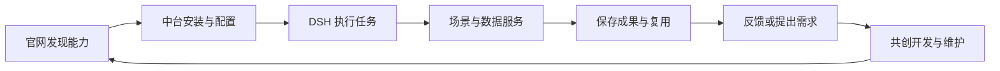

# 产品概览

[文档中心](README.md) / 产品体系

## 定位

**Harness-Based Agentic Data Engineering — 基于 Harness 的智能体数据工程。**

以数据中台为核心，基于 Harness 执行底座，通过插件化能力驱动个人、团队与企业的 AI 场景应用，构建数据互通的智能执行闭环，实现能力持续复用与生态演进。

Beelli X 将执行能力、数据能力和业务应用组织在同一套插件体系中。用户从任务或场景开始工作，开发者通过统一契约提供能力，使用过程中产生的资料与业务成果进入对应的数据服务。

## 三层职责

| 层次 | 主要职责 |
| --- | --- |
| Harness 执行底座 | 任务执行、会话与运行上下文、工具、技能、子代理及本机执行权限；当前客户端接入采用 DSH 原生机制 |
| Beelli X 中台 | 应用安装与配置、模型接入、数据能力组织、资源发现与访问，以及相应的管理界面 |
| 插件与场景应用 | 提供数据库、知识库等公共能力，或实现报价、进销存、CRM 等专业业务及工作台 |

中台的统一管理与各插件的数据责任相互配合。场景保有自己的业务规则和数据结构，通过公共契约访问其他能力；数据库的存储隔离与系统内的数据互通分别设计。

Harness 的运行上下文用于执行当前任务；知识资料、业务记录、数据定义和授权范围由中台及相关服务管理，按任务需要提供给执行底座。

## 官网与生态平台

官网连接用户、作品和共创者，承担插件发现、接入指南、发行获取、需求协作、团队套件及企业服务入口。客户端通过中台把获得的能力接入日常工作。

官网管理平台账号、作品、发行和协作关系；客户环境保存会话、凭据及业务资料。文件分享、运行信息与成果发布按具体操作的授权范围处理。

## 产品形态

| 形态 | 组织方式 |
| --- | --- |
| 社区版 | DSH 客户端、社区中台入口与按需安装的插件，采用本机主用户身份组织个人工作 |
| 团队与企业版 | 本地 DSH 执行端配合共享中台服务；由服务器统一管理成员授权、模型出口、共享数据及审计 |

本仓库维护社区版入口。团队与企业版的服务端部署、人员权限和接入流程在对应产品中实现；各形态的实际发行与验证记录分别维护。

## 共创与服务

社区通过开放使用、作品贡献、衍生改进和需求协作积累能力。后续团队与企业服务围绕部署、集成、企业权益及持续维护组织交付，共创者依据明确的合作与收益约定参与。

平台使用统一账号体系；作者、维护者和团队成员分别对应作品或工作空间中的关系。企业权益描述产品与服务范围，业务数据访问由所在工作空间的人员授权决定。

本仓库的 MIT 许可与已取得的开源权利持续按许可适用。具体作品、交付范围和服务进度见相应说明。

[功能说明](features.md) · [安装与首次使用](getting-started.md) · [架构](architecture.md) · [验证说明](verification.md)
